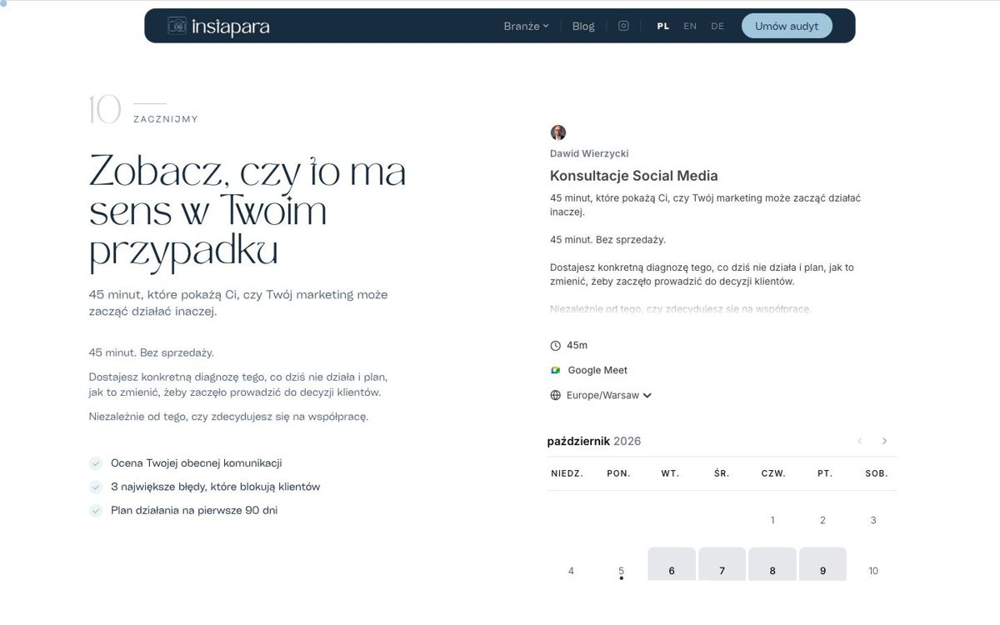

# instapara.pl

Strona agencji marketingowej **InstaPara**, która pomaga prawnikom, klinikom medycyny estetycznej i agentom nieruchomości budować zaufanie w sieci. Strona ma przekonać eksperta, że marketing wideo ma sens, i doprowadzić go do rezerwacji bezpłatnej konsultacji.

**👉 [instapara.pl](https://instapara.pl)**


## Co jest na stronie

- **Strona główna** prowadzi przez problem, system C.A.S.H., efekty, współpracę i zespół, z animacjami przy przewijaniu.
- **Podstrony branżowe** z osobnym przekazem: [/prawnicy](https://instapara.pl/prawnicy), [/kliniki](https://instapara.pl/kliniki), [/nieruchomosci](https://instapara.pl/nieruchomosci).
- **Blog ekspercki** z filtrowaniem po kategoriach i danymi strukturalnymi artykułów.
- **Rezerwacja konsultacji** w wbudowanym kalendarzu Cal.com.
- **Opinie z Trustpilota** i trzy wersje językowe: PL, EN, DE.
- **Wspólna zgoda na cookies** dla strony i sklepu [sklep.instapara.pl](https://sklep.instapara.pl). Google Analytics 4 działa w trybie zgody Google, a piksel Meta ładuje się dopiero po akceptacji.
- **SEO i wyszukiwarki AI:** mapa strony, dane strukturalne (firma, osoby, artykuły), `llms.txt`, `robots.txt` otwarty dla botów AI, obrazek do udostępniania linków.





## Technologie

- [Next.js 15](https://nextjs.org) (eksport statyczny), React 19, TypeScript
- Tailwind CSS 4, Framer Motion
- Cal.com, Trustpilot, Google Analytics 4 z trybem zgody, piksel Meta
- Hosting: Hostinger (Apache, reguły w `public/.htaccess`), wdrożenie skryptem przez API Hostingera

## Struktura

| Ścieżka | Zawartość |
|---|---|
| `src/app/` | strona główna, podstrony branżowe, blog i artykuły, polityka prywatności |
| `src/components/` | sekcje strony, kalendarz, baner zgód, piksel Meta |
| `src/lib/` | tłumaczenia PL, EN, DE i lista artykułów |
| `src/context/` | przełącznik języka |
| `public/` | zdjęcia, mapa strony, `robots.txt`, `llms.txt`, `.htaccess` |
| `scripts/deploy-hostinger.mjs` | wdrożenie na Hostinger |

## Uruchomienie

```bash
npm install
npm run dev                  # http://localhost:3000
npm run build:hostinger      # strona statyczna w folderze out/
```

Strona używa dwóch czcionek z płatną licencją, których nie ma w repozytorium. Szczegóły w [`public/fonts/README.md`](public/fonts/README.md).

## Wdrożenie

```bash
cd out && zip -qr /tmp/instapara_deploy.zip . && cd ..
HOSTINGER_API_TOKEN=... node scripts/deploy-hostinger.mjs
```

Token API Hostingera nie jest przechowywany w repozytorium.

## Autor

Projekt i kod: **Dawid Wierzycki** · [dawidwierzycki.pl](https://dawidwierzycki.pl) · [github.com/wierza](https://github.com/wierza)

Kod udostępniony do wglądu jako przykład realizacji. Treści, zdjęcia i marka InstaPara należą do InstaPara.
